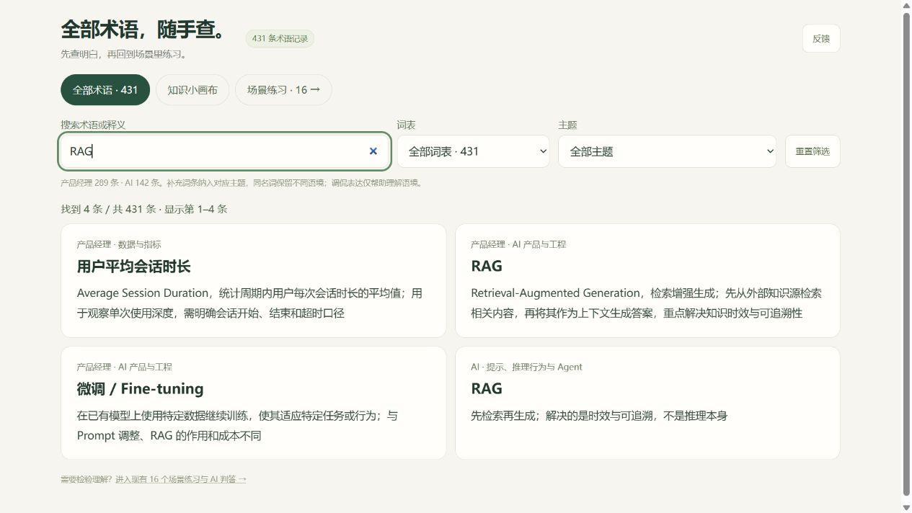
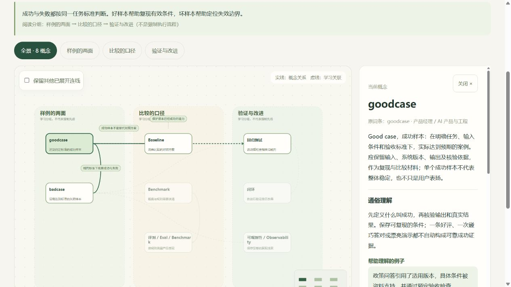

# 黑话学习工具

用速查、关系画布和场景练习，把 AI 与产品术语讲成明白话。

**[直接打开网页版 →](https://philixz.github.io/jargon-learning/)**

当前快照包含 **431 条术语记录、10 个串讲专题、16 个场景练习**。同名术语保留不同语境；专题关系经过人工整理，不自动给所有概念连线。




## 能做什么

- 按关键词、词表与主题查找术语。
- 缩放、拖动画布，查看关系、通俗解释、例子、反例与复习题。
- 写下自己的解释、展开参考要点、自评掌握状态。
- 将草稿、自评和 AI 反馈保存到当前浏览器。
- 使用内置服务接收反馈；记录留在运行服务的电脑。
- 可选配置云端模型，获得依据公开练习和参考要点的 AI 辅助判答。

这是可独立运行的开源项目。**无需工具箱账号或本地模型即可查阅与练习。** 自定义主题编辑、原工具箱账号、配额、共享 GPU 队列和 AI 后端公网服务不包含在此版本中。

## 在线使用

打开 [黑话学习工具网页版](https://philixz.github.io/jargon-learning/)，无需安装。支持 431 条术语速查、10 个专题画布、16 个场景练习、参考要点和浏览器内自评。

GitHub Pages 仅托管静态网页，在线版暂未连接 AI 判答；反馈入口转到 GitHub Issues。API Key 不会放进网页。希望使用可选云端 AI 或本机反馈收件时，请按下文运行本地服务。

## 本地运行

需要 Python 3.10 或更高版本，不需要安装第三方包。

在项目根目录打开终端：

```sh
python serve.py
```

浏览器打开 [本地预览](http://127.0.0.1:18120/)。这个地址只用于本机开发，在线访问请用上方网页版入口。

Windows 如果 `python` 不可用，可用 `py -3 serve.py`。端口已占用时运行 `python serve.py --port 18121`，再访问对应地址。按 `Ctrl+C` 停止服务。

请通过 HTTP 服务访问，直接双击 HTML 的 `file://` 方式无法可靠加载 JSON。服务固定监听本机回环地址，不会打开公网通道。

## 可选：配置云端 AI 判答

不配置也能使用速查、画布、参考要点和自评。未配置时，页面会明确显示 AI 未配置，不会请求模型。

1. 将 `.env.example` 复制为项目根目录的 `.env`。
2. 填入提供商的兼容接口基础地址、模型名称与自己的 Key：

```dotenv
AI_BASE_URL=https://your-provider.example/v1
AI_MODEL=your-model-name
AI_API_KEY=your-own-key
```

3. 重新启动 `serve.py`，刷新练习页。
4. 点击“提交给 AI 辅助判答”时，服务才向配置的提供商发送该题题目、参考要点和本次回答。Key 只由本地服务读取，不发送到浏览器。

仅支持云端 HTTPS、兼容 `/chat/completions` 的非流式文本接口。此适配器不调用本地或内网模型；同一服务一次只处理一个 AI 请求，失败或结果未确认不会自动重试。提供商可能收费，AI 反馈也可能出错，自评状态始终由用户决定。

AI 的原答和反馈只保存在浏览器，不写入服务端学习数据库。浏览器数据不跨设备同步，清理站点数据会删除这些记录。

## 反馈和数据位置

页面右上角的“反馈”会提交表单内容及当前页面位置，不会自动附带练习原答。内置服务将反馈写入 `.local/feedback.sqlite3`；该目录被 Git 排除。

关闭表单后草稿保留在当前浏览器。提交成功会显示收件编号；请求失败不会显示虚假的“已收到”。本地收件服务不是公开社区的反馈后台。

仅运行静态托管时，页面和参考练习仍可使用，`/api/config`、`/api/judge`、`/api/feedback` 需要另行实现。公开部署前还需补齐认证、滥用防护、用量限制和隐私说明；内置服务只用于本机开发。

## 项目结构

```text
public/                  可公开的静态文件
  index.html             独立首页
  base.css               独立页面基础样式
  jargon/                术语速查、知识画布、练习及内容 JSON
serve.py                 本地服务与可选云端判答适配器
tests/                   不调用真实模型的验证
docs/images/             项目截图
.env.example             空配置模板
LICENSE                  自行编写代码的 MIT 协议
LICENSE_SCOPE.txt        代码与内容的授权范围
THIRD_PARTY_NOTICES.md   内容授权和修改说明
```

## 本地验证

```sh
python -m unittest discover -s tests -v
python tests/check_project.py
```

测试使用临时数据库与本机临时 HTTP 服务，不需要 Key、不调用真实模型。人工检查建议覆盖：搜索 goodcase、切换专题、缩放、从原词条返回画布、展开参考要点、保存草稿和提交一条测试反馈。

## 参与完善

词条与专题的修改方式、关系准确性要求和提交前检查见 [CONTRIBUTING.md](CONTRIBUTING.md)。可通过 [Issues](https://github.com/philixz/jargon-learning/issues) 报告问题或建议，通过 Pull Request 提交修改。

## 当前状态与计划

主仓库：[philixz/jargon-learning](https://github.com/philixz/jargon-learning)，默认分支为 `main`。静态网页版通过 GitHub Pages 发布，主站 Vercel 与本地公网通道仍保持关闭。

发布流程见 `.github/workflows/pages.yml`：验证通过后仅将 `public/` 构建到 `dist/`，适配仓库子路径并部署到 Pages。不会发布本地服务、密钥或运行数据。

后续方向：内容校对与专题扩充、移动端细节、可配置的反馈接收、可选 AI 适配器完善。自定义主题功能暂缓。

[青椒工具箱主站](https://walaoxia-ai-toolbox.vercel.app/)可能处于暂停测试状态；本项目的本地功能不依赖主站可用性。

## 协议

自行编写的代码采用 [MIT License](LICENSE)。词表及衍生内容沿用各自授权，见 [授权范围](LICENSE_SCOPE.txt) 和 [内容说明](THIRD_PARTY_NOTICES.md)，不将全部数据笼统改为 MIT。用户草稿、真实反馈、API Key 和运行日志不随仓库发布。
